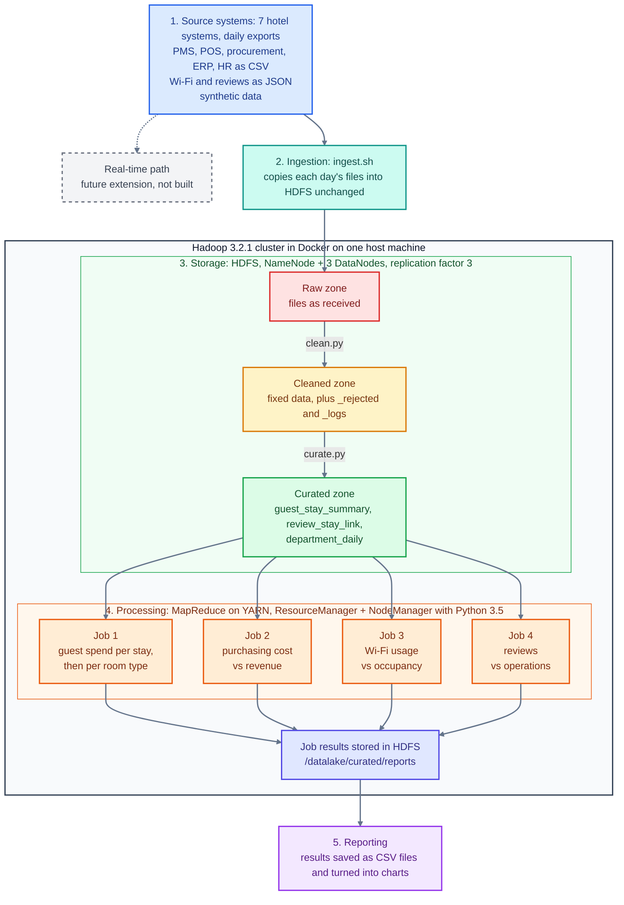

# Hotel Data Lake

ISIT312 Big Data Management group project, University of Wollongong in Dubai.

A Hadoop data lake prototype for a 5-star hotel in Dubai. The hotel's systems work well on their own, but data from different systems cannot easily be combined into one report. This project brings seven hotel systems into one HDFS data lake every night, cleans and links the data, and runs MapReduce jobs that produce cross-system reports for management.

All data in this repository is **synthetic**, generated from a data model based on the hotel's IT department's description of its systems. No real hotel data was used, and the hotel is kept anonymous.

## Architecture

The data lake runs on a Hadoop 3.2.1 cluster in Docker on one host machine. Data moves through five layers: source systems, ingestion, storage zones, processing and reporting. Each night, `pipeline/run_pipeline.sh` loads, cleans and joins the data, then `mapreduce/run_jobs.sh` runs the four MapReduce analysis jobs.



- **Source systems:** PMS, POS, procurement, ERP, HR, guest Wi-Fi and guest reviews (CSV, JSON and free text).
- **Raw zone** (`/datalake/raw`): files exactly as received, never edited.
- **Cleaned zone** (`/datalake/cleaned`): dates, room numbers and department names standardised, duplicates removed, missing values handled. Rows that cannot be fixed go to `_rejected`, and run counts go to `_logs`.
- **Curated zone** (`/datalake/curated`): three joined datasets with guest identifiers masked:
  - `guest_stay_summary`: PMS + POS + Wi-Fi, joined on room number + date
  - `review_stay_link`: PMS + reviews, joined on reservation ID
  - `department_daily`: procurement + ERP + HR, joined on department + date
- **Reports** (`/datalake/curated/reports`): output of four MapReduce jobs: guest spend per stay, purchasing cost vs revenue, Wi-Fi usage vs occupancy, and reviews vs operations.

## Repository structure

| Folder | Contents |
|---|---|
| `cluster/` | Docker setup for the Hadoop cluster and the script that creates the data lake zones |
| `data_generator/` | Synthetic data generator for the seven hotel systems |
| `pipeline/` | Ingestion, cleaning and curation scripts, and the nightly run script |
| `mapreduce/` | MapReduce analysis jobs (Python, Hadoop Streaming) and the script that runs them |
| `experiment/` | Timing experiment showing why MapReduce is not suitable for real-time processing |
| `charts/` | Charts made from the MapReduce output |

## Cluster

Hadoop 3.2.1 running in Docker on one machine:

| Container | Role |
|---|---|
| namenode | HDFS metadata |
| datanode1, datanode2, datanode3 | HDFS storage (replication factor 3) |
| resourcemanager | YARN job scheduling |
| nodemanager | Runs job tasks, and the Python pipeline (custom image with Python 3) |

Web interfaces: HDFS at http://localhost:9870, YARN at http://localhost:8088.

## Requirements

- Docker Desktop (on Windows, with WSL 2)
- Git Bash, or another bash shell, for the `.sh` scripts
- About 10 GB of RAM available to Docker

## How to run

All commands are run in Git Bash, starting from the repo's main folder.

1. **Start the cluster.** The first time, `--build` creates the NodeManager image with Python 3:
```
cd cluster
docker compose up -d --build
```
   Wait about a minute, then check that http://localhost:9870 shows three live DataNodes.

2. **Create the data lake zones** (still in `cluster/`), then go back to the main folder:
```
bash create_zones.sh
cd ..
```

3. **Generate the synthetic data** with the generator in `data_generator/`. Put the output in `cluster/data/`, with one subfolder per source (`pms`, `pos`, `procurement`, `erp`, `hr`, `wifi`, `reviews`).

4. **Run the nightly pipeline** (ingestion, cleaning, curation):
```
bash pipeline/run_pipeline.sh all
```

5. **Run the MapReduce jobs:**
```
bash mapreduce/run_jobs.sh
```
   Results are written to `/datalake/curated/reports/` in HDFS and to `mapreduce_output/` in the main folder.

6. **Stop the cluster:**
```
cd cluster
docker compose down
```
   Do not add `-v`, as that deletes all data stored in HDFS.

## Notes for Windows

- In Git Bash, HDFS paths such as `/datalake/raw` are converted into Windows paths (`C:/...`) and the commands fail with `No FileSystem for scheme "C"`. The scripts already turn this off. When typing commands by hand, run this first:
```
export MSYS_NO_PATHCONV=1 MSYS2_ARG_CONV_EXCL="*"
```
- After a DataNode is stopped, the NameNode marks it as dead after one to two minutes (shortened in `hadoop.env` from the default of about ten minutes). Reading a file before then can fail with `UnresolvedAddressException`.

## Tools

Docker, Hadoop 3.2.1 (HDFS, YARN, MapReduce), Python 3 with Hadoop Streaming. All open source.
