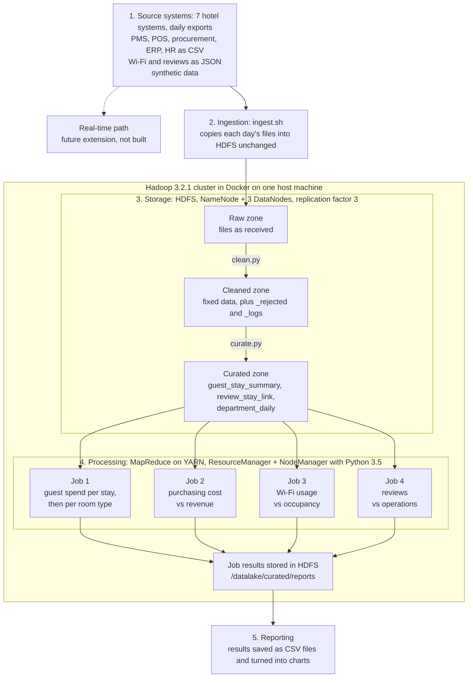

# Architecture

The data lake runs on a Hadoop 3.2.1 cluster in Docker on one host machine. Data moves through five layers: source systems, ingestion, storage zones, processing and reporting. Each night, `pipeline/run_pipeline.sh` loads, cleans and joins the data, then `mapreduce/run_jobs.sh` runs the four MapReduce analysis jobs.

| Layer | What happens | Folder in this repo |
| --- | --- | --- |
| 1. Source systems | Seven hotel systems export daily CSV and JSON files (synthetic data) | `data_generator/` |
| 2. Ingestion | The daily files are copied into the Raw zone unchanged | `pipeline/` |
| 3. Storage | HDFS holds the Raw, Cleaned and Curated zones, with three copies of each block | `cluster/` |
| 4. Processing | Python programs clean and join the data between zones; four MapReduce jobs (Hadoop Streaming) analyse the Curated zone and write their results to `/datalake/curated/reports` | `pipeline/`, `mapreduce/` |
| 5. Reporting | The job results are saved as CSV files and turned into charts | `charts/` |
